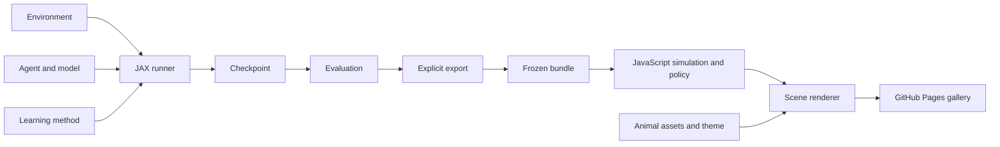

# Architecture and repository organization

## Five distinct responsibilities

| Concept | Owns | Does not own |
| --- | --- | --- |
| `Environment` | Dynamics, observations, rewards, task termination, action availability | Learning, batching, rendering, parameter updates |
| `Model` | A parameterized function: Q-table, Q-network, actor, critic, dynamics predictor | Rollouts, exploration schedules, optimizer steps |
| `Agent` | Policy inputs, parameter sharing, action selection, inference carry | Environment rules, training orchestration, animal artwork |
| `Method` | Learning rule, optimizer/target state, data requirements, freeze operation | Scene rendering, output directories |
| Runner | Collection, reset, batching, update cadence, counters | Method-specific mathematical updates |

`Model` means a function representation. In model-based RL, a **dynamics model**
predicts transitions and rewards; it is a particular model with a different
signature. A Q-network is also a model, but using it does not make DQN model-based.

An animal in a scene is an environment entity with an agent slot and a visual skin.
It need not own a unique neural network. Two mice may share a policy; a mouse and a
monkey may share one too if their observations and action semantics match.

## Principles

- Composition through explicit Python constructors. A short recipe should show
  the environment, representation, method, and information access in one place.
- Stable signatures over elaborate inheritance. Base classes document a small
  contract; duck-typed implementations can satisfy it without registration.
- Functional JAX internals. Configuration is static; evolving values are PyTrees.
  NumPy conversion, disk writes, progress bars, and plotting stay outside JIT.
- Single-world environment semantics. Batch `[B]` and time `[T]` axes are added by
  runners. Agent `[A]` is an intrinsic axis, not interchangeable with batch.
- Training and execution information are distinct. A global critic input does
  not silently become an actor input.
- Compatible components are selectable. Algorithms declare required model outputs,
  observations, action spaces, and data ordering; names alone are insufficient.
- Keep method implementations readable. Extract shared code when a second real
  method needs it; do not begin with a callback engine or plugin registry.
- Publishing is an explicit operation on an evaluated checkpoint. Training never
  silently overwrites the deployed demo.

## Proposed tree

This is a destination map. Add files as their corresponding milestones land.

```text
design/                         # these decisions and contracts
src/marlax/
  __init__.py                   # Environment, Model, Agent, Method, train, evaluate
  core/
    environment.py              # contract and timestep/spec records
    model.py                    # init/apply contract
    agent.py                    # policy execution and sharing
    method.py                   # init/update/freeze contract
    data.py                     # transition and rollout records
  envs/
    coop_grid.py
    foraging.py                 # later, with the corresponding demo
  models/
    tabular.py
    mlp.py                      # later, optional neural dependencies
    dynamics.py                 # later, explicit prediction contract
  policies/
    discrete.py                 # greedy, epsilon-greedy, later categorical
  methods/
    q_learning.py
    sarsa.py
    expected_sarsa.py
    dyna_q.py                    # later, small joint-state/action example
    dqn.py                      # later
    ppo.py                      # later IPPO/MAPPO implementations
  runners/
    online.py                   # first: immediate tabular updates
    off_policy.py               # later: replay and target schedules
    on_policy.py                # later: trajectories and PPO epochs
  evaluation.py
  storage.py                    # checkpoints, metadata, metrics
  export/
    bundle.py                   # manifest and policy arrays
    coop_grid.py                # environment encoding and scene projection
experiments/
  coop_grid_td/
    run.py                      # readable recipe and small CLI
    README.md                   # question, commands, interpretation
  foraging/
examples/
  custom_environment.py         # when extension API exists
  custom_model.py
runs/<experiment>/<run-id>/      # ignored, resumable training outputs
artifacts/<demo>/<revision>/     # selected frozen bundles, tracked
web/
  runtime/                      # reusable native JavaScript ES modules
    index.js
    policy/
    envs/
    simulation.js
  renderer/                     # scene projection, canvas, interpolation
  assets/                       # animal sources, manifests, theme
  gallery/                      # page source and demo catalog
  build.mjs                     # copies sources/assets/bundles into site/
site/                           # generated static GitHub Pages output
tests/                          # a few fast contract checks
STYLE.md                        # scientific figure style, already present
```

Python library code never imports `experiments`. Experiments import the package.
The JavaScript runtime imports neither gallery UI nor the renderer. The gallery
depends on runtime + renderer + assets. The `export` layer depends on frozen
inference descriptions, not browser internals or a generic Python serializer.



## Dependencies and packaging

Keep `pip install marlax` CPU-usable with JAX as the main dependency. GPU support
remains an explicit installation choice. Add a `neural` extra for Flax/Optax when
needed, and keep plotting/storage extras out of inference imports. Small initial
checkpoints can use JSON plus NPZ; Zarr becomes useful only for larger stored data.

Use native JavaScript modules initially. `web/runtime` is a library boundary in
this repository before it is an npm package. A static copy/build command produces
`site/`; deployment uploads it without training. A standalone runtime package can
be published later if another consumer appears.

## Current code mapped to the design

| Current code | Change when implementing |
| --- | --- |
| `CooperativeGridWorld(num_envs=...)` | One-world environment; move batch size to runner |
| `env.state_id(...)` required by learner | Tabular observation encoding; other environments can return features |
| `env.step(...)` automatically resets | Return true final transition; runner performs reset |
| `IndependentQLearning` owns action selection, Q state, updates, scan | Split table, discrete policy, Q-learning method, and runner |
| NumPy evaluation duplicates dynamics | Evaluate through the same Python environment step |
| Experiment module globals | Explicit recipe configuration saved with the run |
| Writes to `latest` and site data during training | Unique run outputs followed by explicit promotion/export |
| `gallery.js` contains everything | Runtime, environment port, renderer, and gallery composition |
| Mouse drawn directly inside gallery | Reusable asset referenced by a scene entity |

Breaking the prototype API is acceptable during this reorganization. Do not build
compatibility shims. Preserve the current saved artifact as a legacy reference,
then export a fresh bundle once the new semantics are settled.
